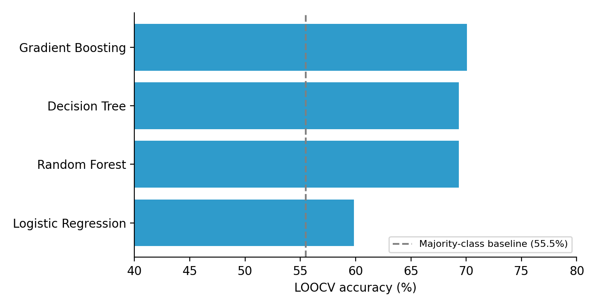

 GLOF Risk Classifier — Gilgit-Baltistan, Pakistan

A Geospatial Machine Learning project to predict the fatality severity of Glacier Lake Outburst Flood (GLOF) events using real historical scientific data spanning 490 years.

About This Project

I am from Hassanabad Valley, Ghanche District, Gilgit-Baltistan — a small valley near the Siachen Glacier in northern Pakistan. Glacier Lake Outburst Floods are not just a research topic for me. They directly threaten communities like mine every year.

This project uses the HMAGLOFDB scientific database — 766 real GLOF events recorded between 1533 and 2025 — to build a machine learning classifier that predicts whether a GLOF event will cause high or low fatalities based on environmental and geographical factors.

Dataset

- **Source:** High Mountain Asia GLOF Database (HMAGLOFDB)
- **Size:** 766 GLOF events — 1533 to 2025
- **Coverage:** High Mountain Asia — Pakistan, India, China, Nepal, Bhutan
- **Key columns:** Lake type, Driver of GLOF, Location coordinates, Lives lost, Season, Year

Dataset available at: github.com/Pavana-karanth/GLOF-dataset-inluded

 What I Built

- Filtered global GLOF database to focus specifically on Pakistan and Ghanche district
- Created binary target label — HIGH FATALITY vs LOW FATALITY — from Lives_total column
- Engineered Season feature from Month data — Summer GLOFs are most dangerous
- Encoded categorical features using LabelEncoder
- Trained and compared three ML models — Random Forest, Gradient Boosting, Decision Tree
- Applied 5-fold cross validation for reliable accuracy measurement
- Created 4 professional geospatial and analytical visualizations

 Results

| Model | Accuracy |
|---|---|
| Random Forest | 66.7% |
| Gradient Boosting | 66.7% |
| Decision Tree | 50.0% |

Key Finding

Geospatial location (Lat_lake, Lon_lake) and the Driver of GLOF (ice avalanche, heavy rainfall, earthquake) are the strongest predictors of fatality severity. Summer events consistently show higher fatality rates — corresponding to peak glacier melt season in Gilgit-Baltistan.

Charts

### GLOF Event Locations in Pakistan — Ghanche District Highlighted

### GLOF Events Over Time (1900-2025)

### What Causes GLOFs?

### Feature Importance — What Predicts Fatality?

### Model Comparison

## Tools Used

- Python
- pandas
- scikit-learn
- matplotlib
- seaborn
- Jupyter Notebook / VS Code
